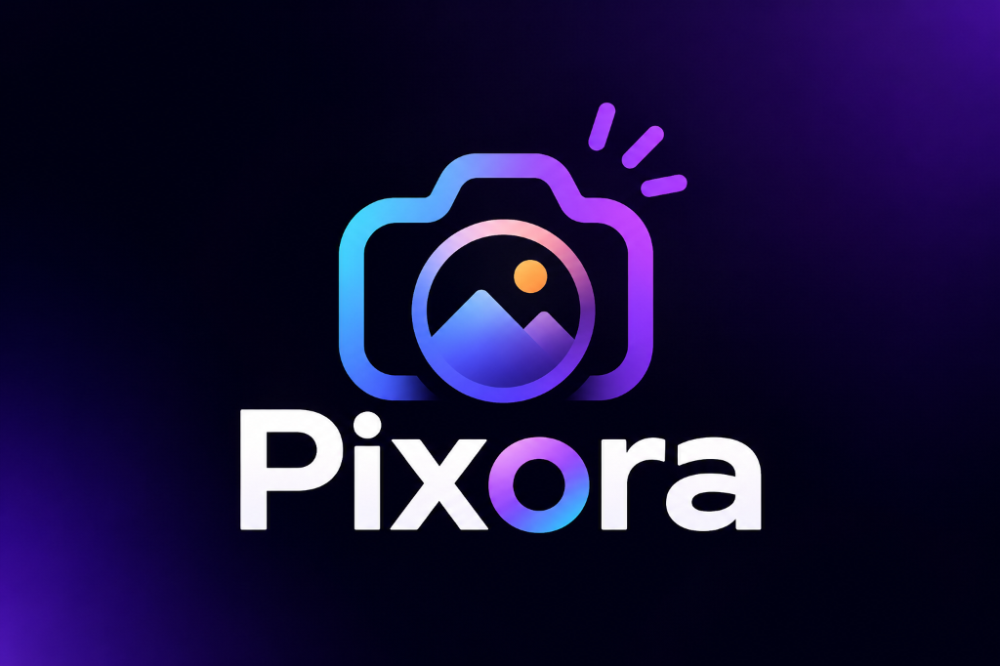

# Pixora — Image Search Application

Pixora is a modern, responsive single-screen web application built with **ReactJS** and the **Unsplash Search Photos API**. It provides an intuitive, visually immersive interface enabling users to discover, search, and preview millions of curated high-resolution photographs with smooth interactions and accessibility.



---

## 🚀 Key Features

* **Instant Keyword Search:** Real-time search with input validation, keyboard shortcuts (`Enter` to submit, `Esc` to clear), and trending topic chips (*Nature*, *Architecture*, *Travel*, *Cars*, *Minimalist*, etc.).
* **Official Unsplash API Integration:** Connects directly to `https://api.unsplash.com/search/photos` with asynchronous data fetching, normalized data models, and request race-condition cancellation via `AbortController`.
* **Responsive Image Gallery:** 
  * 🖥️ **Desktop:** 4-column layout
  * 📱 **Tablet:** 2-to-3-column layout
  * 📱 **Mobile:** 2-column layout adapting down to 320px
* **Shimmering Skeleton Loader:** 12-card animated skeleton placeholders matching the grid geometry while requests are pending.
* **Hover & Touch Details Overlay:** Displays photograph titles, photographer avatars, usernames, and like counts with smooth transitions. Optimized for desktop hover, mobile touch toggles, and keyboard focus.
* **Full Image Preview Modal (Lightbox):** High-resolution image preview with photographer credentials, like counts, image dimensions, direct Unsplash photo link, download action, and keyboard `Escape` / backdrop dismissal.
* **Pagination Controls:** Previous/Next buttons, active page indicators, total pages count, and smooth auto-scroll to results on page change.
* **Resilient Error & Empty States:** Clear feedback for empty search queries, network failures, rate limit handling (50 req/hr Unsplash demo limit), and missing API keys.
* **Curated Fallback Showcase Mode:** When no API key is set, the application gracefully activates an interactive demo showcase so evaluators can test all UI interactions out-of-the-box.
* **Unsplash Compliance & Attribution:** Full compliance with Unsplash API guidelines including UTM referral links (`utm_source=pixora&utm_medium=referral`) and photographer profile attribution.

---

## 🛠️ Tech Stack

* **Frontend Framework:** React 19
* **Build Tool & Dev Server:** Vite 8
* **Icons:** Lucide React
* **Styling:** Modern CSS3 with Custom Properties (CSS variables), Flexbox, CSS Grid, and responsive media queries
* **Testing:** Vitest, React Testing Library, `@testing-library/jest-dom`, JSDOM
* **Version Control:** Git

---

## 📁 Project Structure

```text
nxt/
├── public/                     # Static assets and favicon
│   └── favicon.svg
├── src/
│   ├── components/             # Modular, reusable React components
│   │   ├── Header.jsx          # Branding & Unsplash status badge
│   │   ├── SearchBar.jsx       # Search input, clear button & trending chips
│   │   ├── ImageGrid.jsx       # Responsive image gallery grid container
│   │   ├── ImageCard.jsx       # Image card with hover details & touch handling
│   │   ├── ImageModal.jsx      # High-res preview lightbox modal
│   │   ├── Loader.jsx          # Shimmer skeleton loader
│   │   ├── Pagination.jsx      # Navigation controls & page counters
│   │   ├── EmptyState.jsx      # Zero-result fallback with suggestions
│   │   └── ErrorState.jsx      # Error handling & API setup instructions
│   ├── services/
│   │   └── unsplash.js         # API client, AbortController, normalization & mock data
│   ├── test/                   # Automated Vitest & React Testing Library tests
│   │   ├── setup.js            # Jest-DOM matchers setup
│   │   ├── unsplash.test.js    # API service unit tests
│   │   ├── SearchBar.test.jsx  # SearchBar interaction tests
│   │   ├── Pagination.test.jsx # Pagination boundary & navigation tests
│   │   ├── ImageModal.test.jsx # Modal lightbox & keyboard Esc tests
│   │   └── App.test.jsx        # Full user search flow integration test
│   ├── App.css                 # Component & layout responsive styling
│   ├── index.css               # Design system tokens, variables & resets
│   ├── App.jsx                 # Application state container
│   └── main.jsx                # React root mount point
├── .env.example                # Environment variables template
├── .gitignore                  # Git ignore rules protecting API keys
├── index.html                  # HTML5 entry with fonts & meta tags
├── package.json                # Project dependencies and test scripts
├── vite.config.js              # Vite & Vitest configuration
└── README.md                   # Project documentation
```

---

## ⚙️ Installation & Local Setup

### 1. Prerequisites
Ensure you have **Node.js (v18 or later)** and **npm** installed on your system:
```bash
node -v
npm -v
```

### 2. Clone the Repository
```bash
git clone <repository-url>
cd nxt
```

### 3. Install Dependencies
```bash
npm install
```

### 4. Configure Unsplash API Access Key
1. Register for a free Unsplash Developer account at [unsplash.com/developers](https://unsplash.com/developers).
2. Create a new application to obtain your **Access Key**.
3. Create a `.env` file in the project root directory:
```bash
cp .env.example .env
```
4. Open `.env` and set your Access Key:
```env
VITE_UNSPLASH_ACCESS_KEY=your_actual_unsplash_access_key
```

> **Note:** If no key is set or the key is not yet configured, Pixora automatically runs in **Curated Showcase Demo Mode**, allowing you to preview the application and test search and modal features immediately.

### 5. Start the Development Server
```bash
npm run dev
```
Open your browser and navigate to the local URL displayed in the terminal (typically `http://localhost:5173`).

---

## 🧪 Running Automated Tests

Run the full test suite covering components, pagination, API normalization, and user interaction flows:

```bash
# Run tests once
npm run test

# Run tests in watch mode
npm run test:watch
```

---

## 📦 Building for Production

To create an optimized production build:

```bash
npm run build
```

To preview the production build locally:

```bash
npm run preview
```

---

## 📜 Git Commit Sequence

In compliance with the project requirements, development was conducted and tracked across meaningful commits:

1. `chore: initialize React application with Vite` — Project setup, configuration, and dependencies
2. `feat: build responsive search interface` — Header, search input, clear button, and trending topic chips
3. `feat: integrate Unsplash search API` — API client service, parameter formatting, and error handling
4. `feat: display responsive image gallery` — Responsive image cards, pre-load colors, and grid layouts
5. `feat: add loading and error states` — Skeleton loaders, empty search states, and error handling
6. `feat: show image details on hover` — Overlay transitions, photographer avatar/meta, and touch support
7. `feat: implement pagination` — Previous/Next pagination controls and smooth scroll behavior
8. `feat: add image preview modal` — Lightbox modal with high-res image, details, and Escape key listener
9. `test: verify search and pagination behavior` — Vitest & React Testing Library test suite
10. `docs: document setup and API configuration` — Comprehensive README and setup guide

---

## ⚖️ Unsplash API Guidelines Compliance

* **API Attribution:** Every photograph links directly to Unsplash with mandatory referral UTM tracking: `?utm_source=pixora&utm_medium=referral`.
* **Photographer Credit:** Photographer names link to their official Unsplash profiles.
* **Credential Safety:** The `.env` file is excluded from Git version control via `.gitignore`, and `.env.example` provides an empty template.
* **Rate Limits:** In accordance with Unsplash's 50 requests/hour limit for demo applications, requests are debounced and cancellations are applied to in-flight requests.

---

## 📄 License

This project is open-source and available under the [MIT License](LICENSE).
